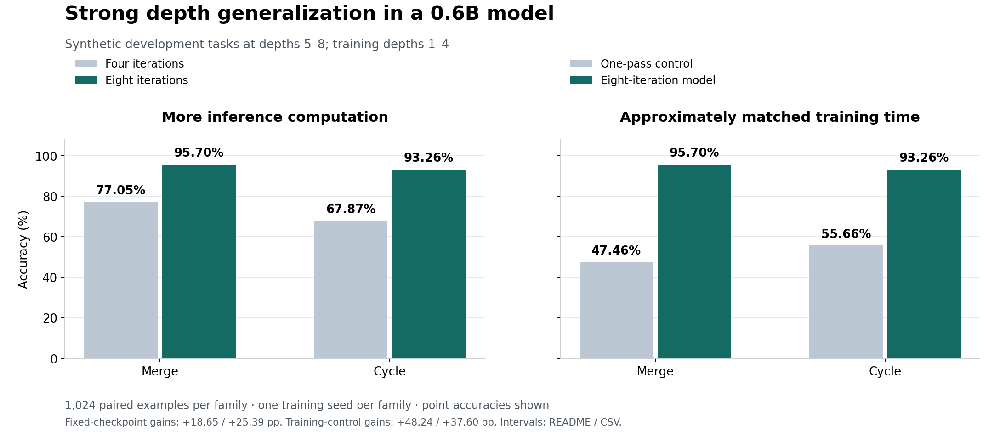

# Latent Core Lab v3

**More useful computation before the answer.**

An independent research project investigating whether frozen language models can gain accuracy from additional internal computation, without retraining the full backbone. The evidence now spans controlled synthetic depth generalization, an early 8B math pilot, and small-model follow-ups that distinguish useful fixed interventions from unproven adaptive compute allocation.

**Seeking a bounded GPU research collaboration for replication and stronger controls.**

## October update: a useful signal, a clear next question

In the latest completed campaign, a **frozen Qwen3-0.6B-Base** answered more mathematical questions correctly after a small learned intervention before answer generation. The backbone weights remained unchanged; Qwen generated the answers.

| Condition | Correct / 128 | Accuracy | Gain over baseline |
|---|---:|---:|---:|
| Unchanged baseline | 42 | 32.81% | — |
| Fixed policy A | **64** | **50.00%** | **+17.19 pp** |
| Fixed policy B | 60 | 46.88% | +14.06 pp |
| Learned adaptive allocation | 56 | 43.75% | +10.94 pp |

For fixed policy A, the paired 95% bootstrap interval is **+7.81 to +26.56 pp**, with 33 corrected answers and 11 regressions. Both fixed configurations were selected before confirmation. These 128 questions come from the **GSM8K training split**, held apart from training and selection **within this campaign**. Some overlap older project data preparation; this is a single-run research result, not an official GSM8K test score.

**The gain does not establish successful learned allocation.** Matched randomized and swapped-budget controls scored 59/128 and 57/128, respectively, versus 56/128 for the learned allocator. Interventions also lengthened visible answers, so the gain cannot yet be attributed to hidden computation alone. Timing comparisons across stages were confounded; no speed or efficiency improvement is claimed.

A separate sealed evaluation rejected another question-conditioned intervention: **5/64 versus 22/64** for its baseline. Preserving baseline behavior under active intervention also remains unresolved. These outcomes narrow the next experiment rather than justify scaling either failed approach unchanged.

Completed campaign: **24 October 2026**. [Methods, controls, and limitations](docs/evidence.md#october-follow-ups) · [Aggregate counts](data/results.csv)

## Earlier evidence: September snapshot

### 1. Extra inference computation improved a fixed checkpoint

On two synthetic graph-traversal families, a 0.6B model trained on depths 1–4 was evaluated on unseen training depths 5–8. Increasing inference computation from four to eight iterations, with **the same trained weights**, produced:

| Task family | Four iterations | Eight iterations | Paired gain | 95% item interval |
|---|---:|---:|---:|---:|
| Merge | 77.05% | **95.70%** | **+18.65 pp** | +16.32 to +20.98 pp |
| Cycle | 67.87% | **93.26%** | **+25.39 pp** | +22.95 to +27.83 pp |

Each comparison uses 1,024 identical evaluation examples. These are development evaluations at greater task depth, with one training seed per family; they are not a multi-seed general reasoning benchmark.

### 2. The advantage survived a stronger training-budget control

Fresh one-pass controls were trained for approximately the same measured training wall time. The eight-iteration models reached **95.70% vs 47.46%** on merge and **93.26% vs 55.66%** on cycle: gains of **48.24** and **37.60 percentage points**. Both controls reached 100% accuracy on in-distribution evaluation depths.

On reserved template variants at depths 5–8, the advantage remained: **90.23% vs 44.14%** and **83.01% vs 53.52%**, with 512 paired examples per family. This comparison involves different trained models; it is separate from the fixed-checkpoint result above. Training time was approximately matched, not independently measured FLOPs.

### 3. An early 8B math signal

A small learned intervention in a **frozen Qwen3-8B** improved direct-answer accuracy by **3.74 percentage points** on **935 GSM8K test questions held apart from configuration selection**: 35 net additional correct answers, with a paired 95% bootstrap interval of **+1.82 to +5.88 pp**.

All compared arms used the same constrained numerical-answer protocol with thinking disabled. This is a task-specific pilot, not a standard unconstrained GSM8K score or a comparison against explicit chain-of-thought reasoning. The condition was selected on a separate discovery subset; its confirmation interval is conditional on that selection and checkpoint.

[Aggregate data](data/results.csv) · [Evidence and limitations](docs/evidence.md) · [Vector figure](assets/results.svg)

## What remains open

- The strongest gains are on synthetic tasks, with one seed per family. Item intervals do not establish reliability across training seeds.
- Harder multi-input composition did not meet the predeclared competence and transfer criteria. Separate active-mode language diagnostics also showed a measurable regression.
- A later natural-thinking benchmark pilot stopped at its budget limit and remains inconclusive.
- General reasoning gains, internal causal mechanisms, production utility, and an efficiency advantage over strong baselines remain to be demonstrated.

## Compute collaboration

The next question is whether the fixed-policy signal survives independent seeds, fresh evaluation data, and strong controls for visible answer length and total inference cost. A successful replication would then justify testing transfer to a larger frozen backbone. The October campaign has not established that transfer.

We are seeking a **small, time-boxed GPU pilot with an agreed hour cap**, followed by a go/no-go review:

1. Freeze the hypothesis, data splits, baselines, and acceptance criteria before evaluation.
2. Replicate the promising fixed-policy comparison across seeds; measure full cost and baseline-skill retention with the intervention active.
3. Consider larger-model experiments only if the first stage passes. A revised adaptive controller would require its own hypothesis and matched controls.

The GPU configuration and hour budget would be agreed after a memory and runtime preflight. The deliverable is an evidence report including negative results, resource use, and the next decision. This repository does not claim that more compute alone will solve the remaining research problems.

## Public scope and contact

This repository contains a selected research summary, aggregate results, and figures. Implementation details, training recipes, checkpoints, and raw benchmark traces remain private. The public package supports inspection of the stated results; it is not a release of the full experimental system.

For a research collaboration, [open a GitHub issue](https://github.com/paulnovy/latent-core-lab-v3/issues) or contact [paulnovy on GitHub](https://github.com/paulnovy).

Public update: **28 October 2026**, covering completed experiments through **24 October 2026**. September results and figures are retained as a separate historical snapshot; their protocols and scores are not directly comparable to the October campaign.
